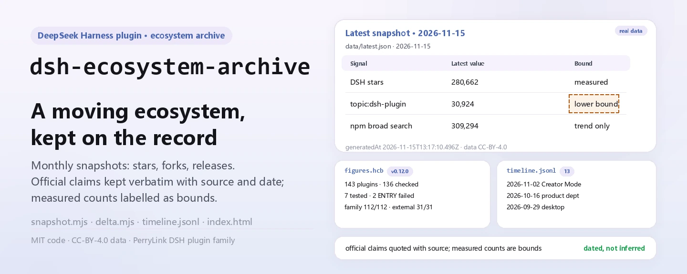
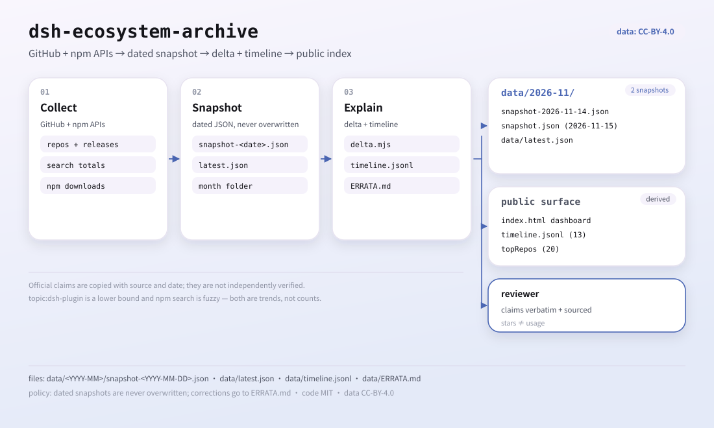

<picture>
  <source media="(prefers-color-scheme: dark)" srcset="docs/assets/dsh-ecosystem-archive-hero-en-dark.webp">
  
</picture>

# dsh-ecosystem-archive

**Instantáneas independientes y reproducibles del ecosistema de plugins de DeepSeek Harness.**

*El ecosistema cambia cada mes y las cifras oficiales son autodeclaradas. Este archivo guarda instantáneas con fecha y una línea de tiempo de eventos para que las afirmaciones futuras puedan contrastarse con un registro. Sin afiliación con DeepSeek: código MIT, datos CC-BY-4.0.*

[English](README.md) · [简体中文](README-zh.md) · [Español](README-es.md) · [Português](README-pt.md) · [हिन्दी](README-hi.md)

---

## Última instantánea (2026-11-15)

*Animación: la salida real del colector (API en vivo de GitHub y npm, ejecutada en una copia temporal el 2026-11-21 para no tocar las instantáneas comprometidas) y el delta real contra la instantánea del 2026-11-14. Las cifras en vivo son más recientes que la instantánea comprometida del 2026-11-15 de la tabla de abajo: es una captura, no una instantánea publicada.*

Archivos de origen: [`data/2026-11/snapshot.json`](data/2026-11/snapshot.json) · [`data/timeline.jsonl`](data/timeline.jsonl)

| Señal | Último valor |
|---|---|
| Repositorio de DSH | 280,662 estrellas · 34,621 forks · 39 releases · última `dsh-v0.2.2-rc.3` |
| `topic:dsh-plugin` en GitHub | 30,924 repositorios |
| Búsqueda npm de `dsh-plugin` (amplia) | 309,294 |
| HCB | **v0.12.0** |
| Plugins de HCB | **143** |
| Evidencia de HCB | **136 comprobados** · 0 declarados · **7 probados** · 2 ENTRY fallidos · 3 FLOW manuales |
| Filas probadas de HCB | **7** — `dsh-plugin-guide@0.5.9` (único production-candidate) + `dsh-budget@0.4.26`, `dsh-defend@0.3.28`, `dsh-mask@0.2.25`, `dsh-memento@0.5.31`, `dsh-observe@0.2.28`, `dsh-test-drive@0.3.26` (runtime ENTRY, host `0.2.2-rc.3`) |
| Cobertura de HCB | **112/112 de la familia** + **31/31 externos** |
| Puerta de HCB | 2 blocked · 31 review · 109 pilot · **1 production-candidate** |

<picture>
  <source media="(prefers-color-scheme: dark)" srcset="docs/assets/dsh-ecosystem-archive-flow-v5-dark.svg">
  
</picture>

*Estructura: recopilar → instantánea → explicar. `scripts/snapshot.mjs` escribe `data/<YYYY-MM>/snapshot-<YYYY-MM-DD>.json` y `data/latest.json`; `scripts/delta.mjs` compara dos instantáneas; `data/timeline.jsonl` y `data/ERRATA.md` registran eventos y correcciones. Una instantánea con fecha nunca se sobrescribe.*

## Qué hay aquí

| Ruta | Significado |
|---|---|
| `data/<YYYY-MM>/snapshot-<YYYY-MM-DD>.json` | instantánea con fecha: estadísticas del repositorio de DSH, recuentos de topic de GitHub, totales de búsqueda de npm, repositorios principales, descargas de paquetes principales |
| `data/latest.json` | la instantánea más reciente |
| `data/timeline.jsonl` | eventos con fecha (releases, métricas, declaraciones) con URL de origen |
| `scripts/snapshot.mjs` | colector reproducible (escribe un archivo con fecha + latest.json) |
| `scripts/delta.mjs` | compara dos instantáneas |
| `index.html` | panel estático |
| `docs/METHODOLOGY.md` | definiciones y limitaciones conocidas |

## Definiciones (importantes)

- **Las afirmaciones oficiales** se registran textualmente con origen y fecha; no se verifican de forma independiente.
- **El recuento de topic de GitHub** es `topic:dsh-plugin`, una cota inferior (muchos plugins no declaran topic).
- **El total de búsqueda de npm** es amplio y difuso; úsalo solo como línea de tendencia, no como recuento.
- **Los repositorios principales** se ordenan por estrellas; las estrellas no son uso.

## Por qué existe esto

Las series temporales no se pueden rellenar hacia atrás. Si el ecosistema es 10 veces mayor en 2028, la única forma de saber cómo era 2026 es haberlo registrado en 2026.

## Hoja de ruta

- Instantáneas mensuales (cron).
- Informe trimestral «estado del ecosistema».
- v1.0: esquema estable + API + DOI de Zenodo.

## Licencia

- Datos: CC-BY-4.0 (atribuya «DSH Ecosystem Archive, PerryLink»).
- Código: MIT.
