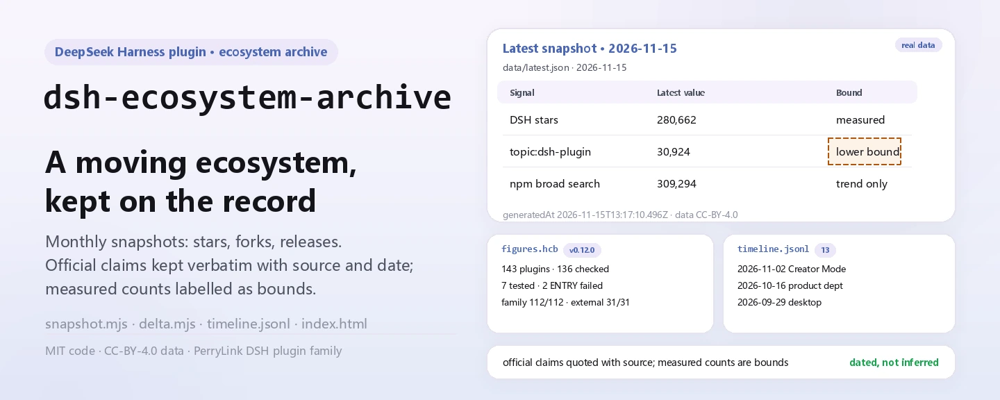
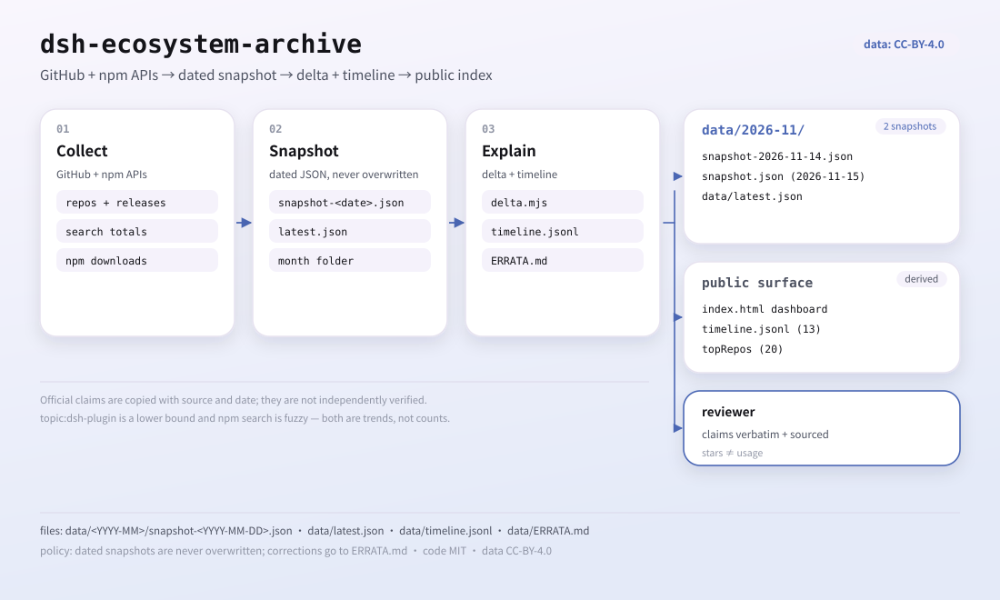

<picture>
  <source media="(prefers-color-scheme: dark)" srcset="docs/assets/dsh-ecosystem-archive-hero-en-dark.webp">
  
</picture>

# dsh-ecosystem-archive

**DeepSeek Harness प्लगइन पारिस्थितिकी की स्वतंत्र, पुनरुत्पाद्य स्नैपशॉट।**

*पारिस्थितिकी हर महीने बदलती है और आधिकारिक आँकड़े स्वयं-घोषित होते हैं। यह संग्रह तारीख़ वाली स्नैपशॉट और घटनाओं की टाइमलाइन रखता है, ताकि आगे के दावे किसी दर्ज रिकॉर्ड से जाँचे जा सकें। DeepSeek से संबद्ध नहीं: कोड MIT, डेटा CC-BY-4.0।*

[English](README.md) · [简体中文](README-zh.md) · [Español](README-es.md) · [Português](README-pt.md) · [हिन्दी](README-hi.md)

---

## नवीनतम स्नैपशॉट (2026-11-15)

*एनिमेशन: कलेक्टर का वास्तविक stdout (लाइव GitHub और npm API, 2026-11-21 को एक अस्थायी प्रति में चलाया गया ताकि कमिट स्नैपशॉट अछूती रहें) और 2026-11-14 की स्नैपशॉट के विरुद्ध वास्तविक delta। लाइव आँकड़े नीचे की कमिट 2026-11-15 स्नैपशॉट से नए हैं — यह एक कैप्चर है, प्रकाशित स्नैपशॉट नहीं।*

स्रोत फ़ाइलें: [`data/2026-11/snapshot.json`](data/2026-11/snapshot.json) · [`data/timeline.jsonl`](data/timeline.jsonl)

| संकेत | नवीनतम मान |
|---|---|
| DSH रिपॉज़िटरी | 280,662 स्टार · 34,621 फ़ोर्क · 39 रिलीज़ · नवीनतम `dsh-v0.2.2-rc.3` |
| GitHub पर `topic:dsh-plugin` | 30,924 रिपॉज़िटरी |
| npm पर `dsh-plugin` खोज (विस्तृत) | 309,294 |
| HCB | **v0.12.0** |
| HCB प्लगइन | **143** |
| HCB साक्ष्य | **136 जाँचे** · 0 घोषित · **7 परखे** · 2 ENTRY विफल · 3 FLOW मैनुअल |
| HCB परखी गई पंक्तियाँ | **7** — `dsh-plugin-guide@0.5.9` (एकमात्र production-candidate) + `dsh-budget@0.4.26`, `dsh-defend@0.3.28`, `dsh-mask@0.2.25`, `dsh-memento@0.5.31`, `dsh-observe@0.2.28`, `dsh-test-drive@0.3.26` (ENTRY रनटाइम, होस्ट `0.2.2-rc.3`) |
| HCB कवरेज | **112/112 परिवार** + **31/31 बाहरी** |
| HCB गेट | 2 blocked · 31 review · 109 pilot · **1 production-candidate** |

<picture>
  <source media="(prefers-color-scheme: dark)" srcset="docs/assets/dsh-ecosystem-archive-flow-v5-dark.svg">
  
</picture>

*संरचना: एकत्र → स्नैपशॉट → व्याख्या। `scripts/snapshot.mjs` `data/<YYYY-MM>/snapshot-<YYYY-MM-DD>.json` और `data/latest.json` लिखता है; `scripts/delta.mjs` दो स्नैपशॉट की तुलना करता है; `data/timeline.jsonl` और `data/ERRATA.md` घटनाएँ और सुधार दर्ज करते हैं। तारीख़ वाली स्नैपशॉट कभी अधिलेखित नहीं होती।*

## यहाँ क्या है

| पथ | अर्थ |
|---|---|
| `data/<YYYY-MM>/snapshot-<YYYY-MM-DD>.json` | तारीख़ वाली स्नैपशॉट: DSH रिपॉज़िटरी आँकड़े, GitHub topic गिनतियाँ, npm खोज कुल, शीर्ष रिपॉज़िटरी, शीर्ष पैकेज डाउनलोड |
| `data/latest.json` | सबसे नई स्नैपशॉट |
| `data/timeline.jsonl` | स्रोत URL के साथ तारीख़ वाली घटनाएँ (रिलीज़, मीट्रिक, वक्तव्य) |
| `scripts/snapshot.mjs` | पुनरुत्पाद्य कलेक्टर (तारीख़ वाली फ़ाइल + latest.json लिखता है) |
| `scripts/delta.mjs` | दो स्नैपशॉट की तुलना |
| `index.html` | स्थिर डैशबोर्ड |
| `docs/METHODOLOGY.md` | परिभाषाएँ और ज्ञात सीमाएँ |

## परिभाषाएँ (महत्वपूर्ण)

- **आधिकारिक दावे** स्रोत और तारीख़ के साथ शब्दशः दर्ज होते हैं; उन्हें स्वतंत्र रूप से सत्यापित नहीं किया जाता।
- **GitHub topic गिनती** `topic:dsh-plugin` है, जो एक निचली सीमा है (कई प्लगइन topic नहीं लगाते)।
- **npm खोज कुल** विस्तृत और धुँधला है; इसे केवल ट्रेंड रेखा की तरह इस्तेमाल करें, गिनती की तरह नहीं।
- **शीर्ष रिपॉज़िटरी** स्टार से क्रमबद्ध हैं; स्टार उपयोग नहीं हैं।

## यह क्यों मौजूद है

समय-शृंखलाएँ पीछे से नहीं भरी जा सकतीं। अगर 2028 में पारिस्थितिकी 10 गुना बड़ी हो, तो यह जानने का एकमात्र तरीका कि 2026 कैसा था — यह है कि 2026 में उसे दर्ज किया गया हो।

## रोडमैप

- मासिक स्नैपशॉट (cron)।
- त्रैमासिक «पारिस्थितिकी की स्थिति» ब्रीफ़।
- v1.0: स्थिर schema + API + Zenodo DOI।

## लाइसेंस

- डेटा: CC-BY-4.0 («DSH Ecosystem Archive, PerryLink» का श्रेय दें)।
- कोड: MIT।
