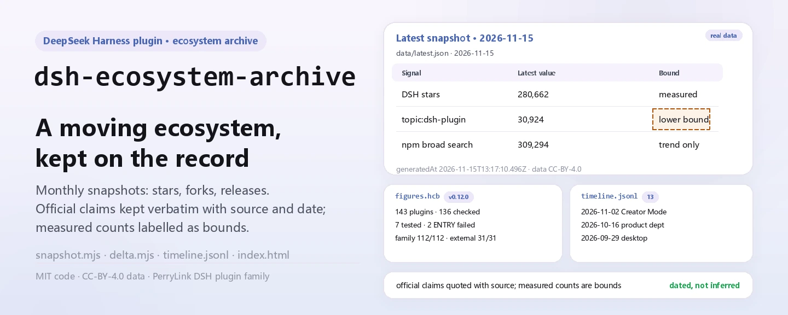
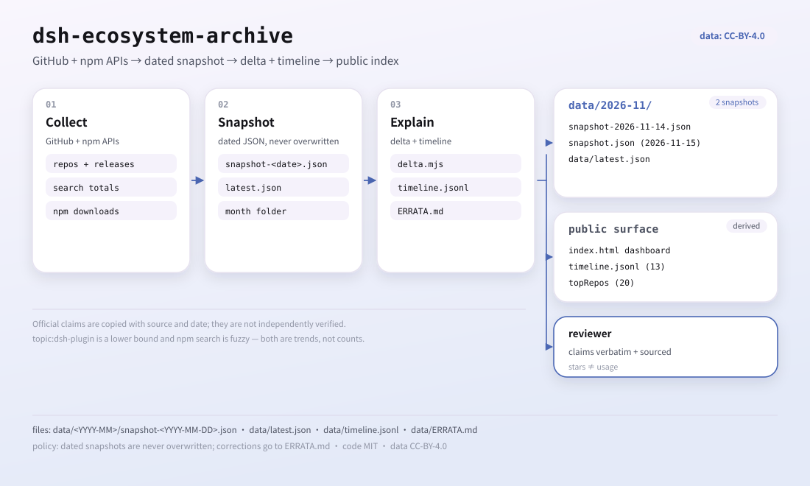

<picture>
  <source media="(prefers-color-scheme: dark)" srcset="docs/assets/dsh-ecosystem-archive-hero-en-dark.webp">
  
</picture>

# dsh-ecosystem-archive

**Instantâneas independentes e reproduzíveis do ecossistema de plugins do DeepSeek Harness.**

*O ecossistema muda todo mês e os números oficiais são autodeclarados. Este arquivo guarda instantâneas com data e uma linha do tempo de eventos para que afirmações futuras possam ser conferidas contra um registro. Sem afiliação com a DeepSeek: código MIT, dados CC-BY-4.0.*

[English](README.md) · [简体中文](README-zh.md) · [Español](README-es.md) · [Português](README-pt.md) · [हिन्दी](README-hi.md)

---

## Última instantânea (2026-11-15)

*Animação: a saída real do coletor (APIs ao vivo do GitHub e do npm, executada numa cópia temporária em 2026-11-21 para não tocar nas instantâneas commitadas) e o delta real contra a instantânea de 2026-11-14. Os números ao vivo são mais recentes que a instantânea commitada de 2026-11-15 da tabela abaixo: é uma captura, não uma instantânea publicada.*

Arquivos de origem: [`data/2026-11/snapshot.json`](data/2026-11/snapshot.json) · [`data/timeline.jsonl`](data/timeline.jsonl)

| Sinal | Último valor |
|---|---|
| Repositório do DSH | 280,662 estrelas · 34,621 forks · 39 releases · última `dsh-v0.2.2-rc.3` |
| `topic:dsh-plugin` no GitHub | 30,924 repositórios |
| Busca npm de `dsh-plugin` (ampla) | 309,294 |
| HCB | **v0.12.0** |
| Plugins do HCB | **143** |
| Evidência do HCB | **136 verificados** · 0 declarados · **7 testados** · 2 ENTRY reprovados · 3 FLOW manuais |
| Linhas testadas do HCB | **7** — `dsh-plugin-guide@0.5.9` (único production-candidate) + `dsh-budget@0.4.26`, `dsh-defend@0.3.28`, `dsh-mask@0.2.25`, `dsh-memento@0.5.31`, `dsh-observe@0.2.28`, `dsh-test-drive@0.3.26` (runtime ENTRY, host `0.2.2-rc.3`) |
| Cobertura do HCB | **112/112 da família** + **31/31 externos** |
| Portão do HCB | 2 blocked · 31 review · 109 pilot · **1 production-candidate** |

<picture>
  <source media="(prefers-color-scheme: dark)" srcset="docs/assets/dsh-ecosystem-archive-flow-v5-dark.svg">
  
</picture>

*Estrutura: coletar → instantânea → explicar. `scripts/snapshot.mjs` grava `data/<YYYY-MM>/snapshot-<YYYY-MM-DD>.json` e `data/latest.json`; `scripts/delta.mjs` compara duas instantâneas; `data/timeline.jsonl` e `data/ERRATA.md` registram eventos e correções. Uma instantânea com data nunca é sobrescrita.*

## O que existe aqui

| Caminho | Significado |
|---|---|
| `data/<YYYY-MM>/snapshot-<YYYY-MM-DD>.json` | instantânea com data: estatísticas do repositório do DSH, contagens de topic do GitHub, totais de busca do npm, repositórios principais, downloads de pacotes principais |
| `data/latest.json` | a instantânea mais recente |
| `data/timeline.jsonl` | eventos com data (releases, métricas, declarações) com URL de origem |
| `scripts/snapshot.mjs` | coletor reproduzível (grava um arquivo com data + latest.json) |
| `scripts/delta.mjs` | compara duas instantâneas |
| `index.html` | painel estático |
| `docs/METHODOLOGY.md` | definições e limitações conhecidas |

## Definições (importantes)

- **As declarações oficiais** são registradas textualmente com origem e data; não são verificadas de forma independente.
- **A contagem de topic do GitHub** é `topic:dsh-plugin`, um limite inferior (muitos plugins não declaram topic).
- **O total de busca do npm** é amplo e difuso; use apenas como linha de tendência, não como contagem.
- **Os repositórios principais** são ordenados por estrelas; estrelas não são uso.

## Por que isto existe

Séries temporais não podem ser preenchidas retroativamente. Se o ecossistema for 10 vezes maior em 2028, a única forma de saber como era 2026 é ter registrado em 2026.

## Roteiro

- Instantâneas mensais (cron).
- Relatório trimestral «estado do ecossistema».
- v1.0: schema estável + API + DOI do Zenodo.

## Licença

- Dados: CC-BY-4.0 (atribua «DSH Ecosystem Archive, PerryLink»).
- Código: MIT.
