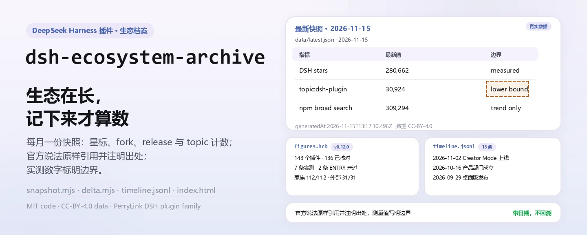
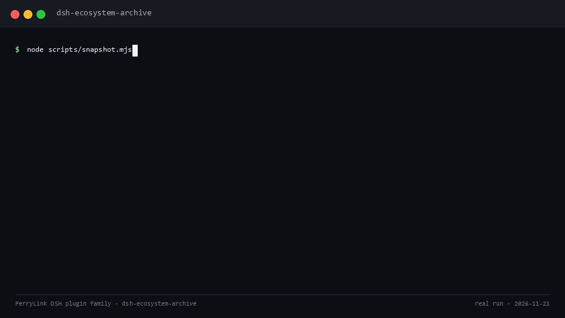
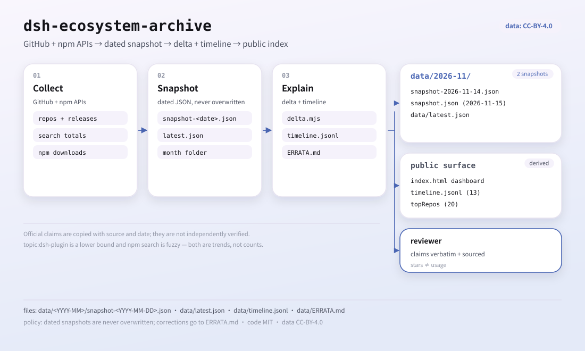

<picture>
  <source media="(prefers-color-scheme: dark)" srcset="docs/assets/dsh-ecosystem-archive-hero-zh-dark.webp">
  
</picture>

# dsh-ecosystem-archive

**给会变的生态留一份可复现的带日期快照。**

*生态每月都在变，官方数字是自报的。本仓保存带日期的快照与事件时间线，让未来的说法可以对着一份记录核查。与 DeepSeek 无关；代码 MIT，数据 CC-BY-4.0。*

[English](README.md) · [Español](README-es.md) · [Português](README-pt.md) · [हिन्दी](README-hi.md)

---

## 最新快照（2026-11-15）

*动图是采集器的真实 stdout（联网 GitHub 与 npm 接口，2026-11-21 在临时副本中运行，已提交快照不受影响）以及针对 2026-11-14 快照的真实 delta。实时数字比下表已提交的 2026-11-15 快照更新——这是一次捕获，不是新发布的快照。*

源文件：[`data/2026-11/snapshot.json`](data/2026-11/snapshot.json) · [`data/timeline.jsonl`](data/timeline.jsonl)

| 信号 | 最新值 |
|---|---|
| DSH 仓库 | 280,662 星标 · 34,621 fork · 39 个 release · 最新 `dsh-v0.2.2-rc.3` |
| GitHub `topic:dsh-plugin` | 30,924 个仓库 |
| npm `dsh-plugin` 搜索（宽口径） | 309,294 |
| HCB | **v0.12.0** |
| HCB 插件 | **143** |
| HCB 证据 | **136 已核对** · 0 已声明 · **7 已实测** · 2 条 ENTRY 未过 · 3 条 FLOW 人工 |
| HCB 实测行 | **7** — `dsh-plugin-guide@0.5.9`（唯一 production-candidate）+ `dsh-budget@0.4.26`、`dsh-defend@0.3.28`、`dsh-mask@0.2.25`、`dsh-memento@0.5.31`、`dsh-observe@0.2.28`、`dsh-test-drive@0.3.26`（ENTRY 运行时，宿主 `0.2.2-rc.3`） |
| HCB 覆盖 | **112/112 家族** + **31/31 外部** |
| HCB 门禁 | 2 blocked · 31 review · 109 pilot · **1 production-candidate** |

<picture>
  <source media="(prefers-color-scheme: dark)" srcset="docs/assets/dsh-ecosystem-archive-flow-v5-dark.svg">
  
</picture>

*结构：采集 → 快照 → 解释。`scripts/snapshot.mjs` 写出 `data/<YYYY-MM>/snapshot-<YYYY-MM-DD>.json` 与 `data/latest.json`；`scripts/delta.mjs` 对比两份快照；`data/timeline.jsonl` 与 `data/ERRATA.md` 记录事件与更正。带日期的快照永不覆盖。*

## 这里有什么

| 路径 | 含义 |
|---|---|
| `data/<YYYY-MM>/snapshot-<YYYY-MM-DD>.json` | 带日期的快照：DSH 仓库统计、GitHub topic 计数、npm 搜索总数、头部仓库、头部包下载量 |
| `data/latest.json` | 最近一次快照 |
| `data/timeline.jsonl` | 带来源 URL 的日期化事件（发布、指标、表态） |
| `scripts/snapshot.mjs` | 可复现的采集器（写出日期文件 + latest.json） |
| `scripts/delta.mjs` | 对比两份快照 |
| `index.html` | 静态仪表盘 |
| `docs/METHODOLOGY.md` | 定义与已知局限 |

## 定义（重要）

- **官方说法**按原文连来源/日期一起记录，不经过独立核验。
- **GitHub topic 计数**是 `topic:dsh-plugin`，只是下界（很多插件没打 topic）。
- **npm 搜索总数**口径宽且模糊；只当趋势线，不要当计数。
- **头部仓库**按 stars 排序；stars 不是使用量。

## 为什么做这个

时间序列无法回填。如果 2028 年生态大了 10 倍，唯一能知道 2026 年长什么样的办法，就是 2026 年真的记下来。

## 路线图

- 每月快照（cron）。
- 每季度「生态现状」简报。
- v1.0：稳定 schema + API + Zenodo DOI。

## 许可

- 数据：CC-BY-4.0（署名 "DSH Ecosystem Archive, PerryLink"）。
- 代码：MIT。
