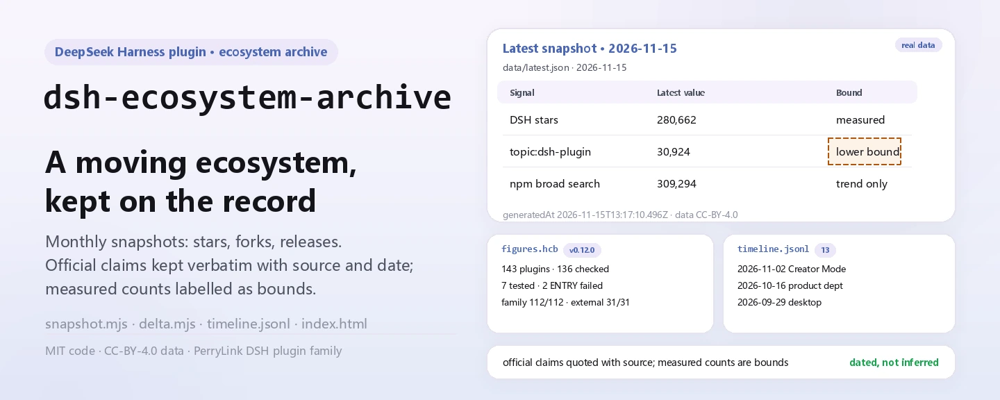
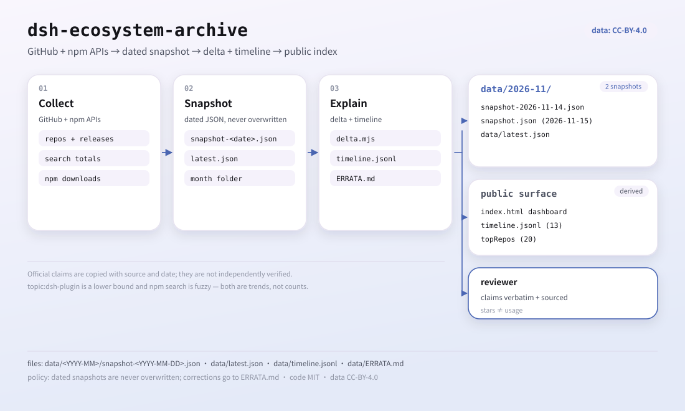

<picture>
  <source media="(prefers-color-scheme: dark)" srcset="docs/assets/dsh-ecosystem-archive-hero-en-dark.webp">
  
</picture>

# dsh-ecosystem-archive

**Independent, reproducible snapshots of the DeepSeek Harness plugin ecosystem.**

*The ecosystem changes monthly and official numbers are self-reported. This archive keeps dated snapshots and an event timeline so future claims can be checked against a record. Not affiliated with DeepSeek — code MIT, data CC-BY-4.0.*

[简体中文](README-zh.md) · [Español](README-es.md) · [Português](README-pt.md) · [हिन्दी](README-hi.md)

---

## Latest snapshot (2026-11-15)

*Animated: the collector's real stdout (live GitHub and npm APIs, run in a temp copy on 2026-11-21 so the committed snapshots stay untouched) and the real delta against the 2026-11-14 snapshot. The live figures are newer than the committed 2026-11-15 snapshot below — a capture, not a published snapshot.*

Source files: [`data/2026-11/snapshot.json`](data/2026-11/snapshot.json) · [`data/timeline.jsonl`](data/timeline.jsonl)

| Signal | Latest value |
|---|---|
| DSH repository | 280,662 stars · 34,621 forks · 39 releases · latest `dsh-v0.2.2-rc.3` |
| GitHub `topic:dsh-plugin` | 30,924 repositories |
| npm `dsh-plugin` search (broad) | 309,294 |
| HCB | **v0.12.0** |
| HCB plugins | **143** |
| HCB evidence | **136 checked** · 0 declared · **7 tested** · 2 ENTRY failed · 3 FLOW manual |
| HCB tested rows | **7** — `dsh-plugin-guide@0.5.9` (only PC) + `dsh-budget@0.4.26`, `dsh-defend@0.3.28`, `dsh-mask@0.2.25`, `dsh-memento@0.5.31`, `dsh-observe@0.2.28`, `dsh-test-drive@0.3.26` (ENTRY runtime, host `0.2.2-rc.3`) |
| HCB coverage | **112/112 family** + **31/31 external** |
| HCB gate | 2 blocked · 31 review · 109 pilot · **1 production-candidate** |

<picture>
  <source media="(prefers-color-scheme: dark)" srcset="docs/assets/dsh-ecosystem-archive-flow-v5-dark.svg">
  
</picture>

*Structure: collect → snapshot → explain. `scripts/snapshot.mjs` writes `data/<YYYY-MM>/snapshot-<YYYY-MM-DD>.json` and `data/latest.json`; `scripts/delta.mjs` diffs two snapshots; `data/timeline.jsonl` and `data/ERRATA.md` record events and corrections. A dated snapshot is never overwritten.*

## What is here

| Path | Meaning |
|---|---|
| `data/<YYYY-MM>/snapshot-<YYYY-MM-DD>.json` | dated snapshot: DSH repo stats, GitHub topic counts, npm search totals, top repos, top package downloads |
| `data/latest.json` | most recent snapshot |
| `data/timeline.jsonl` | dated events (releases, metrics, statements) with source URLs |
| `scripts/snapshot.mjs` | reproducible collector (writes a dated file + latest.json) |
| `scripts/delta.mjs` | compare two snapshots |
| `index.html` | static dashboard |
| `docs/METHODOLOGY.md` | definitions, known limitations |

## Definitions (important)

- **Official claims** are recorded verbatim with source/date; they are not independently verified.
- **GitHub topic count** is `topic:dsh-plugin`, a lower bound (many plugins do not set topics).
- **npm search total** is broad and fuzzy; use it only as a trend line, not a count.
- **Top repos** are sorted by stars; stars are not usage.

## Why this exists

Time series cannot be backfilled. If the ecosystem is 10x bigger in 2028, the only way to know what 2026 looked like is to have recorded it in 2026.

## Roadmap

- Monthly snapshots (cron).
- Quarterly "state of the ecosystem" brief.
- v1.0: stable schema + API + Zenodo DOI.

## License

- Data: CC-BY-4.0 (attribute "DSH Ecosystem Archive, PerryLink").
- Code: MIT.
